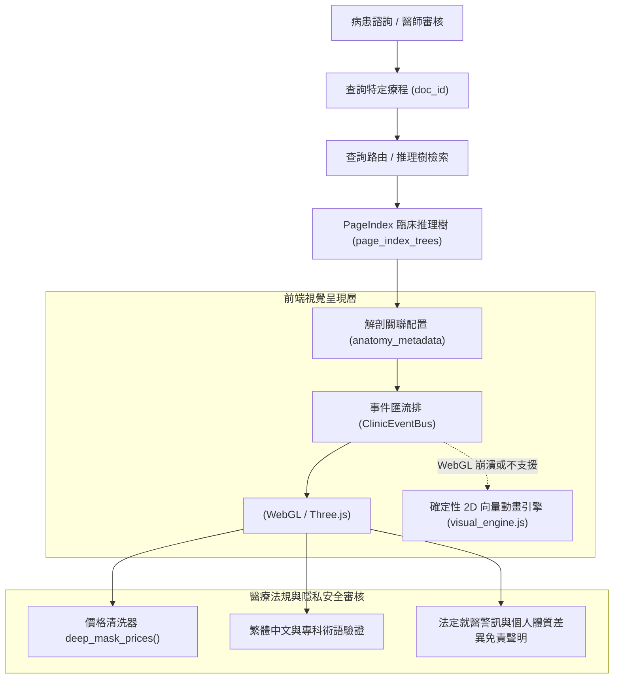
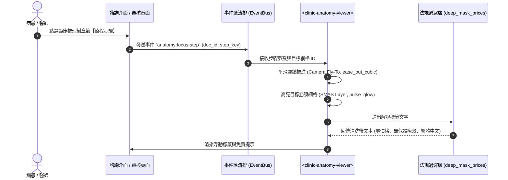

# ClinicBrain 3D 臨床解剖檢視器前端組件架構與 PageIndex 關聯設計規格書

> **文件狀態**：規格定稿 (Architecture Specification)  
> **所屬階段**：Phase 41 Plan 03  
> **核心目標**：規範未來 3D 臨床解剖檢視組件架構、PageIndex 臨床推理樹關聯契約與醫療法規防線。

---

## 1. 系統定位與架構全景

本模組旨在為 ClinicBrain 提供輕量、受控、具備 2D 降級備援的 **3D 臨床解剖檢視組件 (`<clinic-anatomy-viewer>`)**，使病患在諮詢對話（`patient_consult`）或醫師在管理後台（`review`）查閱特定療程時，能動態聚焦於手術部位之立體解剖結構。



---

## 2. 前端組件規格與生命週期 (`<clinic-anatomy-viewer>`)

### 2.1 組件邊界
* **封裝方式**：原生 Web Component (`customElements.define('clinic-anatomy-viewer', ...)` 或輕量級 iframe 沙盒)，杜絕全域 CSS 與 JS 污染。
* **渲染技術棧**：Three.js 核心子集 + WebGL 2.0，支援 Draco / Meshopt 網格解壓縮。
* **體積預算**：核心播放器代碼 $\le 120\text{KB}$ (gzip)，專科解剖資產包 $\le 3\text{MB}$。

### 2.2 生命週期與錯誤降級 (Graceful Degradation)
1. **延遲載入 (Lazy Loading)**：使用者未滑動或未點擊展開「3D 解剖視角」前，僅渲染骨架屏（Skeleton Loader），不發起 3D 網格網路請求。
2. **上下文自癒機制**：監聽 `webglcontextlost` 事件，若遭遇記憶體不足被瀏覽器回收，自動釋放未啟用網格資源並於 `webglcontextrestored` 重建場景。
3. **2D 向量降級防線**：若行動端或瀏覽器完全不支援 WebGL 或記憶體多次崩潰，自動無縫切換至既有之確定性 2D 向量解說卡（`visual_engine.js`），確保使用者體驗永不中斷。

---

## 3. PageIndex 臨床推理樹關聯契約 (Data Contract)

為維持資料庫單一權威與最小侵入性，解剖定位資訊掛載於 `page_index_trees` 或獨立靜態設定目錄：

### 3.1 結構化設定定義 (`anatomy_metadata`)
```json
{
  "doc_id": "hifu-lifting",
  "anatomy_target": "facial_smas",
  "specialty": "aesthetic_plastic_surgery",
  "camera": {
    "default_position": [0.0, 1.2, 2.5],
    "target": [0.0, 1.1, 0.0],
    "pitch": 12.0,
    "yaw": -25.0,
    "zoom": 1.35
  },
  "interactive_steps": [
    {
      "step_key": "procedure",
      "action": "highlight_layer",
      "target_mesh": "mesh_smas_layer",
      "glow_color": "#FFB800",
      "camera_fly_to": {"zoom": 1.8, "duration": 1.2},
      "caption": "音波聚焦能量穿透表皮與真皮，精準作用於皮下四點五毫米之淺筋膜層（SMAS）"
    },
    {
      "step_key": "pre_op",
      "action": "warning_zone",
      "target_mesh": "nerve_marginal_mandibular",
      "glow_color": "#FF4D4F",
      "caption": "避開顏面神經下頜緣支與顳支之行經區域，盡量減低神經損傷可能"
    }
  ]
}
```

### 3.2 互動事件時序圖 (Sequence Diagram)


---

## 4. 多層醫療法規與隱私安全防禦

1. **嚴格價格清洗 (`deep_mask_prices`)**：
   * 3D 解剖浮動標籤（Annotation Tooltip）輸出前，必須嚴格經過 `deep_mask_prices()` 遞迴清洗，絕對禁止任何價格數字外洩。
2. **無保證療效與免責聲明**：
   * 檢視器畫布右下角固定標註：
     > 「3D 解剖模型僅供衛教輔助參考，解剖結構存在個人體質差異，實際手術計畫以門診醫師親自評估為準。」
3. **全繁體中文與台灣專科名詞**：
   * 所有解剖部位（如「頸闊肌」、「咬肌筋膜」、「胸大肌」）強制符合台灣中華民國解剖學會之標準譯名，杜絕未校準之簡體名詞。
4. **零外部網路外連 (Fail-Closed Offline Security)**：
   * 所有 3D 網格檔案、材質貼圖與字型一律打包於本地靜態資料夾（`src/web/static/anatomy/`），嚴禁向任何外部第三方伺服器發送遙測請求。

---

## 5. 後續實作驗收條件 (Milestone Gate Criteria)

當專案推進至下一階段（Phase 44+ 3D 組件實裝）時，必須滿足以下準則方可進入正式庫：
1. **資產體積合規**：局部專科網格包體積必須經過裁剪與壓縮，限制在 $3\text{MB}$ 以內。
2. **自動化渲染測試**：完成 Playwright 3D WebGL 無頭渲染測試，確認在 60fps 運行下 Forward / Reverse Seek 行為確定。
3. **臨床醫師簽核**：由緻妍專科醫師完成解剖位置與標籤之最終雙盲簽核。
